<p align="center">
  
</p>

<h1 align="center">AirGuard · System Architecture & Feature Workflow</h1>

<p align="center">
  <b>How raw air-quality data becomes a personal decision.</b><br>
  Data pipelines, the exposure model, and a function reference for every module.
</p>

<p align="center">
  
  
  
  
  
  
  
</p>

> **AQI tells you what the air is like. AirGuard tells you what to do about it.**

---

## Contents

1. [Vision](#1-vision)
2. [System architecture](#2-system-architecture)
3. [Onboarding and health profile](#3-onboarding-and-health-profile)
4. [Telemetry and sensor fusion](#4-telemetry-and-sensor-fusion)
5. [Personal exposure engine](#5-personal-exposure-engine)
6. [Clean-air smart routes](#6-clean-air-smart-routes)
7. [Best time planner](#7-best-time-planner)
8. [Activity risk simulator](#8-activity-risk-simulator)
9. [AI Guardian pipeline](#9-ai-guardian-pipeline)
10. [Pollution map and hotspots](#10-pollution-map-and-hotspots)
11. [Design system](#11-design-system)
12. [Function and symbol reference](#12-function-and-symbol-reference)
13. [AWS cloud roadmap](#13-aws-cloud-roadmap)
14. [Limitations and disclaimer](#14-limitations-and-disclaimer)

---

## 1. Vision

Regional AQI numbers come from a few distant stations and treat everyone the same. A runner breathing about 55 L/min and a person resting indoors at about 7 L/min are handed the same number.

AirGuard closes that gap in four moves:

| Step | What it does | Where it lives |
| :-- | :-- | :-- |
| **Sense** | Pulls local air and weather data, plus an optional ESP32 sensor stream | `weatherApi.ts` |
| **Personalize** | Weights the air by activity, duration, age, and health profile | `aqiCalculator.ts` |
| **Advise** | Turns the score into a route, a time window, and a plain-language answer | Route, planner, AI modules |
| **Act** | Shows one clear next step, not a dashboard of numbers | Dashboard |

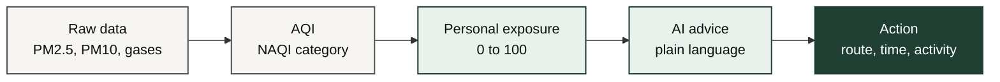

---

## 2. System architecture

<p align="center">
  
</p>

*Figure 2.1. Four-stage pipeline feeding five feature modules. All computation runs in the browser.*

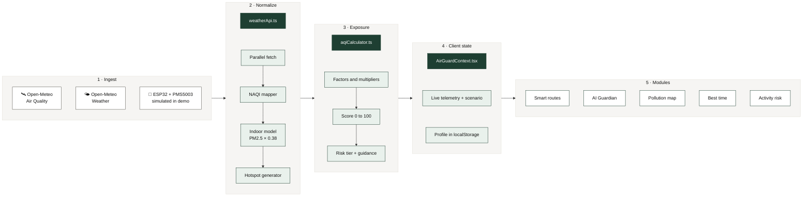

---

## 3. Onboarding and health profile

Before it can weigh the air for a person, AirGuard needs a baseline. First-time visitors get a short guided setup. Returning visitors skip it because the profile is rehydrated from `localStorage`.

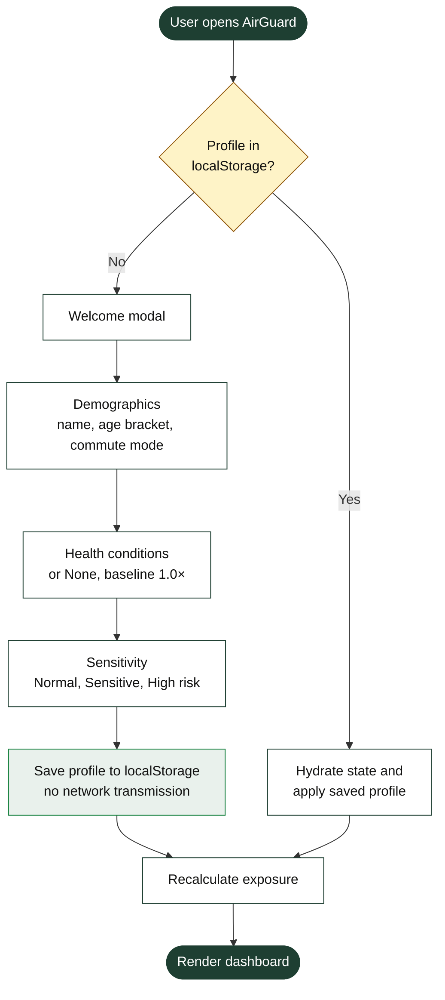

| Choice | Options | Effect on the model |
| :-- | :-- | :-- |
| Age bracket | under 12, 12 to 60, over 60 | +0.25 vulnerability outside 12 to 60 |
| Conditions | None, mild or severe asthma, COPD, bronchitis, allergies, sinusitis, cardiovascular | +0.35 for respiratory conditions |
| Sensitivity | Normal, Sensitive, High risk | +0.10 Sensitive, +0.20 High risk |
| Commute mode | Walking, cycling, transit, car | Sets the default activity |

The **None** chip keeps the multiplier at 1.0×, so healthy adults are never shown false alarms.

> **Privacy.** The profile lives only in the browser. Nothing about health or conditions is sent to a server or third party.

---

## 4. Telemetry and sensor fusion

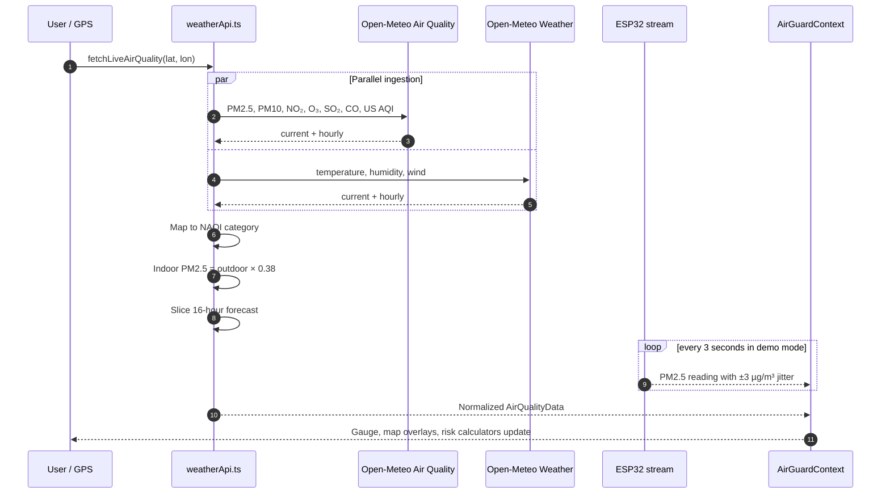

### Sensor simulation

When no hardware is attached, a 3-second timer applies a bounded random walk to mimic the optical scatter of a laser particle sensor:

$$\text{PM2.5}_{t} = \max\left(15,\ \min\left(180,\ \text{PM2.5}_{t-1} + (\mathcal{R} - 0.48) \times 3\right)\right)$$

where $\mathcal{R}$ is uniform on $[0, 1)$. The listener has the same shape as the real ESP32 path, so swapping in hardware changes the data source, not the UI.

| Data | Source | Refresh |
| :-- | :-- | :-- |
| PM2.5, PM10, NO₂, O₃, SO₂, CO, US AQI | Open-Meteo Air Quality | On location change and manual refresh |
| Temperature, humidity, wind | Open-Meteo Weather | Same |
| Sensor PM2.5 | ESP32 + PMS5003, or the simulator | Every 3 s |
| Indoor PM2.5 | Derived: outdoor × 0.38 | Whenever outdoor changes |

---

## 5. Personal exposure engine

<p align="center">
  
</p>

*Figure 5.1. Four factors multiply, scale by 25, and clamp to 0 to 100.*

Implemented in [`src/utils/aqiCalculator.ts`](src/utils/aqiCalculator.ts).

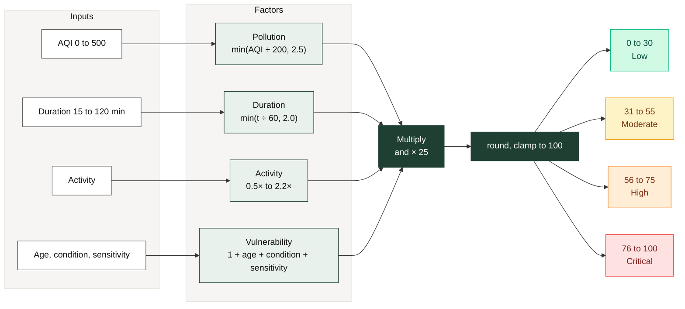

### Formula

$$\text{Exposure} = \min\left(100,\ \text{round}\left(F_{\text{pollution}} \times F_{\text{duration}} \times M_{\text{activity}} \times M_{\text{vulnerability}} \times 25\right)\right)$$

| Symbol | Definition |
| :-- | :-- |
| $F_{\text{pollution}}$ | $\min(\text{AQI} / 200,\ 2.5)$ |
| $F_{\text{duration}}$ | $\min(t / 60,\ 2.0)$ |
| $M_{\text{activity}}$ | Sitting 0.5, walking 1.0, commuting 1.2, cycling 1.5, running 2.0, outdoor sports 2.2 |
| $M_{\text{vulnerability}}$ | $1 + \Delta_{\text{age}} + \Delta_{\text{condition}} + \Delta_{\text{sensitivity}}$ |
| $\Delta_{\text{age}}$ | +0.25 if age under 12 or over 60 |
| $\Delta_{\text{condition}}$ | +0.35 if a respiratory condition is present |
| $\Delta_{\text{sensitivity}}$ | +0.20 High risk, +0.10 Sensitive |

### Worked examples (AQI 276)

| Who and what | $F_p$ | $F_d$ | $M_a$ | $M_v$ | Raw | Score | Tier |
| :-- | :-: | :-: | :-: | :-: | :-: | :-: | :-- |
| Healthy adult, walking 20 min | 1.38 | 0.33 | 1.0 | 1.00 | 11.5 | **12** | 🟢 Low |
| Child with mild asthma, walking 60 min, Sensitive | 1.38 | 1.00 | 1.0 | 1.70 | 58.7 | **59** | 🟠 High |
| Healthy adult, running 60 min | 1.38 | 1.00 | 2.0 | 1.00 | 69.0 | **69** | 🟠 High |
| Adult with asthma, High risk, running 60 min | 1.38 | 1.00 | 2.0 | 1.55 | 107.0 | **100** | 🔴 Critical |

The tier colors are `#10b981` Low, `#f59e0b` Moderate, `#f97316` High, and `#ef4444` Critical.

---

## 6. Clean-air smart routes

Standard navigation optimizes only for time. AirGuard compares **two corridors** and shows what each costs in exposure, not just minutes.

<p align="center">
  
</p>

*Figure 6.1. Route A (expressway) against Route B (green canopy). Four extra minutes cuts the exposure score by 49%.*

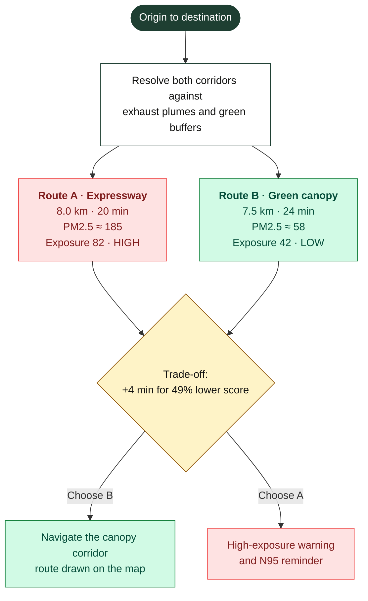

| | Route A · Expressway | Route B · Green canopy |
| :-- | :-: | :-: |
| Distance | 8.0 km | 7.5 km |
| Time | 20 min | 24 min (+4) |
| PM2.5 | about 185 µg/m³ | about 58 µg/m³ |
| Traffic | Heavy diesel | Light, tree-lined |
| Exposure score | 82 / 100 | 42 / 100 |

Interface notes: route cards use fluid heights so long descriptions never overflow, location badges truncate gracefully, and the layout flips from one column on mobile to two on desktop.

---

## 7. Best time planner

Pollution follows a daily rhythm. Overnight, a cold ground layer traps particulates. After sunrise the boundary layer expands and dilutes them, until rush-hour traffic pushes concentrations back up.

<p align="center">
  
</p>

*Figure 7.1. Illustrative diurnal pattern (demo data). The green band is the recommended window.*

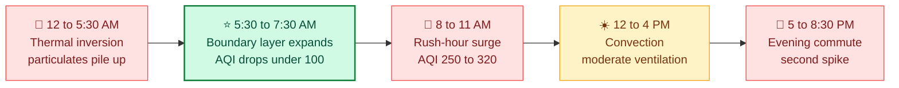

**In `BestTimePlanner.tsx`:** the hourly forecast comes from Open-Meteo; a filter picks hours with AQI below 120 between 05:00 and 08:00; a Recharts area chart draws the curve and highlights the recommended band.

---

## 8. Activity risk simulator

Users test an activity before leaving home. Choose the effort, choose the duration, and read the score in the same 0 to 100 scale as everywhere else. Implemented in [`src/components/ActivityRiskCalculator.tsx`](src/components/ActivityRiskCalculator.tsx).

| Activity | Typical ventilation | Multiplier |
| :-- | :-: | :-: |
| Sitting | 7 L/min | 0.5× |
| Walking | 15 L/min | 1.0× |
| Commuting | 18 L/min | 1.2× |
| Cycling | 30 L/min | 1.5× |
| Running | 55 L/min | 2.0× |
| Outdoor sports | 65 L/min | 2.2× |

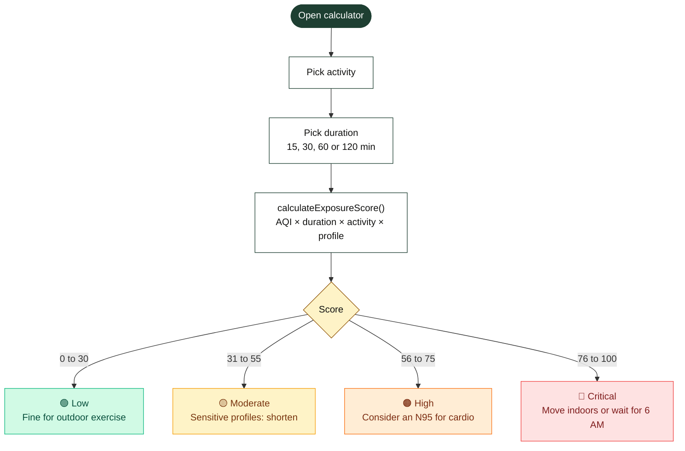

---

## 9. AI Guardian pipeline

[`src/services/aiService.ts`](src/services/aiService.ts) answers in two layers. The cloud model gives richer answers; the rule engine means the assistant **always answers**, even with no key or no network.

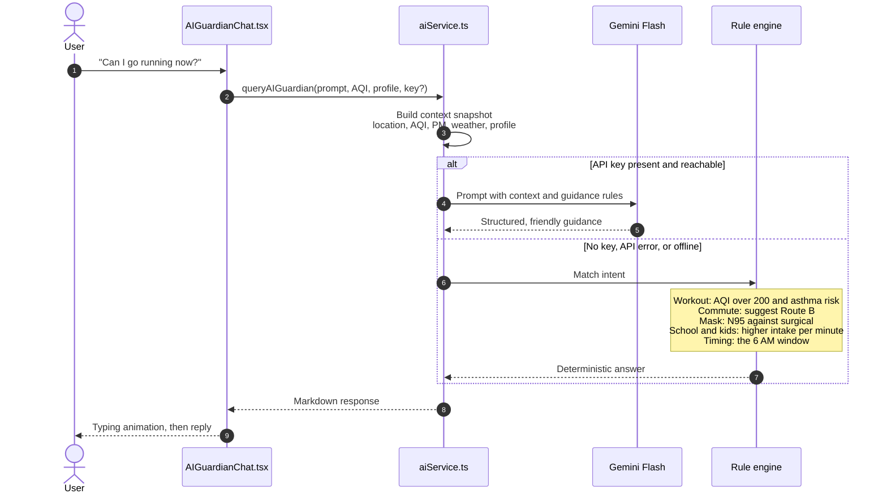

| Intent | Rule-engine behavior |
| :-- | :-- |
| Workout or cardio | Checks AQI above 200 and the user's risk profile |
| Commute | Recommends the Route B green corridor |
| Masks | Compares N95 and surgical masks for particulate capture |
| School or children | Explains higher intake per minute for young lungs |
| Timing | Points to the 6 AM dispersion window |

---

## 10. Pollution map and hotspots

Built with **Leaflet** and **React-Leaflet** in [`src/components/InteractivePollutionMap.tsx`](src/components/InteractivePollutionMap.tsx).

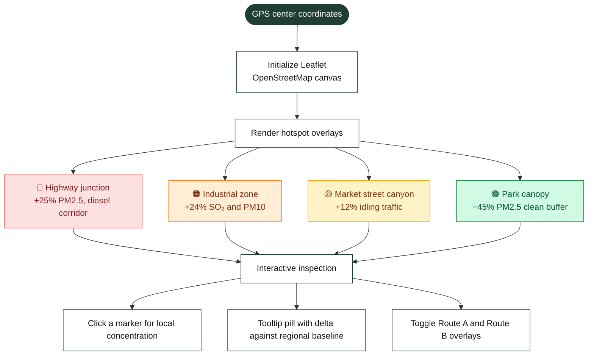

---

## 11. Design system

Light and dark themes share one set of CSS variable tokens.

| Token | Light | Dark | Use |
| :-- | :-- | :-- | :-- |
| `--bg` | `#f6f5f3` | `#0f1011` | Page canvas |
| `--card` | `#ffffff` | `#18191b` | Card surface |
| `--ink` | `#111110` | `#fdfcf9` | Primary text |
| `--mut` | `#54524c` | `#a9a7a0` | Secondary text |
| `--line` | `#e2dfd7` | `#292a2e` | Borders and dividers |
| `--ac` | `#1e3f32` | `#4ade80` | Primary accent |
| `--ac2` | `#92580c` | `#fbbf24` | Moderate tier |
| `--ok` | `#15803d` | `#34d399` | Healthy tier |

**Measured contrast on the page background:** body text, muted text, and the primary accent reach AAA (7:1 or better) in both themes. In light mode, `--ac2` (5.3:1) and `--ok` (4.6:1) meet AA, so use them for large text, icons, and badges rather than small body copy.

### Elevated cards (`.card-3d`)

Layered shadows plus a thin top highlight give cards a tactile lift.

```css
/* light */
box-shadow: 0 1px 2px rgba(0,0,0,.04), 0 8px 24px -4px rgba(20,20,20,.07), inset 0 1px 0 rgba(255,255,255,.9);
/* dark */
box-shadow: 0 2px 6px rgba(0,0,0,.5), 0 14px 34px -6px rgba(0,0,0,.75), inset 0 1px 0 rgba(255,255,255,.08);
```

On hover the card lifts 2 px and its shadow widens.

---

## 12. Function and symbol reference

<details open>
<summary><b><code>src/utils/aqiCalculator.ts</code></b></summary>

| Symbol | Purpose |
| :-- | :-- |
| `getAQICategory(aqi)` | Returns the NAQI category (`good`, `satisfactory`, `moderate`, `poor`, `verypoor`, `severe`), its color, and a description |
| `calculateExposureScore(aqi, durationMinutes, activity, userProfile)` | Computes the 0 to 100 personal exposure index |
| `ACTIVITY_MULTIPLIERS` | Maps each activity to its intake multiplier |

</details>

<details>
<summary><b><code>src/services/weatherApi.ts</code></b></summary>

| Symbol | Purpose |
| :-- | :-- |
| `fetchLiveAirQuality(lat, lon, locationName)` | Queries both Open-Meteo endpoints in parallel and returns normalized `AirQualityData` |
| `searchLocationsOnline(query)` | Forward geocoding: text to city coordinates |
| `reverseGeocodeOnline(lat, lon)` | GPS coordinates to a readable place name |

</details>

<details>
<summary><b><code>src/services/aiService.ts</code></b></summary>

| Symbol | Purpose |
| :-- | :-- |
| `queryAIGuardian(prompt, currentAQI, userProfile, apiKey?)` | Tries Gemini first, falls back to the deterministic rule engine |

</details>

<details>
<summary><b><code>src/context/AirGuardContext.tsx</code> and <code>src/hooks/useTheme.ts</code></b></summary>

| Symbol | Purpose |
| :-- | :-- |
| `AirGuardProvider` | Root provider: location, live telemetry, sensor noise, profile, scenarios, active tab |
| `useAirGuard()` | Hook giving any component access to state and actions |
| `useTheme()` | Syncs `data-theme="dark\|light"` and the `.dark` class with `localStorage` |

</details>

---

## 13. AWS cloud roadmap

> **Status: planned, not yet built.** The prototype runs fully in the browser. This is the path to a hosted, multi-user version, and it fits the existing `services/` layer without UI changes.

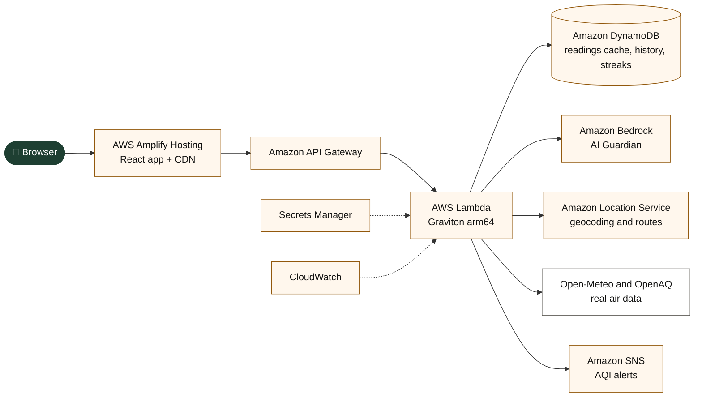

| Today | Planned on AWS | Why |
| :-- | :-- | :-- |
| Gemini key in the browser | **Bedrock** behind Lambda | Keys stay server-side |
| Leaflet + OpenStreetMap | **Amazon Location Service** | Managed routes and geocoding |
| `localStorage` profile | **DynamoDB** (opt-in sync) | Multi-device history |
| Static demo scenarios | **DynamoDB** scenarios table | Editable without redeploy |
| None | **SNS** alerts | Notify when AQI crosses 250 |
| Local dev server | **Amplify Hosting** | Auto-deploy from git, HTTPS, CDN |

---

## 14. Limitations and disclaimer

> **AirGuard is a hackathon prototype. Exposure scores are informational estimates, not medical advice.** The model is a transparent demo formula, not a clinically validated one. Talk to a doctor about health decisions.

| Area | Current state | Next step |
| :-- | :-- | :-- |
| Exposure model | Simple multiplicative demo model | Calibrate against published dose-response studies |
| Sensor | Simulated unless an ESP32 is attached | Validate with a real PMS5003 |
| Hotspots and route scores | Generated around the user from rules | Use real traffic and land-use data |
| AI key | Stored in browser `localStorage` | Proxy through a backend |
| Forecast | Open-Meteo model output | Add local station calibration |
| AI model ID | A specific Gemini Flash version | Confirm the version is still served before demo day |

---

<p align="center"><sub>AirGuard · Hackathon engineering documentation · v1.3.0</sub></p>
