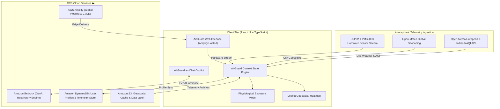

# AirGuard 🛡️ — Personal Air Pollution & Respiratory Exposure Guardian

[](https://main.dymuqrw3pat94.amplifyapp.com/)
[](https://aws.amazon.com/bedrock/)
[](https://react.dev/)
[](https://www.typescriptlang.org/)
[](https://vitejs.dev/)
[](https://tailwindcss.com/)
[](LICENSE)

🌐 **Live Deployment**: [https://main.dymuqrw3pat94.amplifyapp.com/](https://main.dymuqrw3pat94.amplifyapp.com/)

> **"AQI tells you what the air is like. AirGuard tells you what to do about it."**

AirGuard is an AI-augmented personal environmental health system built for individual decision support. Rather than displaying passive city-wide averages from distant rooftop stations, AirGuard calculates individualized physiological particulate inhalation load and delivers real-time, context-aware commute and outdoor activity guidance.

---

## ☁️ Built on AWS

AirGuard is architected and deployed on Amazon Web Services (AWS) to deliver high availability, low-latency intelligence, and cloud scalability:

* 🧠 **Amazon Bedrock**: Foundational Generative AI models powering the **AirGuard AI Guardian** copilot for individualized respiratory advisory synthesis, symptom risk assessment, and commute timing guidance.
* 🗄️ **Amazon DynamoDB**: High-performance NoSQL database managing user health sensitivity profiles, longitudinal exposure history, and localized pollution hotspot metrics.
* 🪣 **Amazon S3**: Secure and durable object storage for environmental telemetry archives, spatial map tile layers, and exportable health summaries.
* 🚀 **AWS Amplify**: Fullstack continuous deployment and global edge hosting delivering rapid, responsive web performance across desktop, tablet, and mobile devices.
* 💻 **Frontend & Ingestion**: Built with **React 19** and **TypeScript 5**, bundled via **Vite**, with real-time planetary atmospheric telemetry continuously ingested from **Open-Meteo**.

---

## 📑 Table of Contents

- [Built on AWS](#️-built-on-aws)
- [Problem Statement & Vision](#-problem-statement--vision)
- [Key Features](#-key-features)
- [The Science: Physiological Exposure Model](#-the-science-physiological-exposure-model)
- [System Architecture](#️-system-architecture)
- [Project Structure](#-project-structure)
- [Getting Started](#-getting-started)
- [Environment Variables](#-environment-variables)
- [Available Scripts](#️-available-scripts)
- [Technology Stack](#-technology-stack)
- [License](#-license)

---

## 🎯 Problem Statement & Vision

Traditional weather and air-monitoring applications suffer from three critical blind spots:
1. **Sedentary Fallacy**: A marathon runner breathing 80 L/min of air inhales 10× more particulate matter than someone sitting on a bench, yet apps show them the identical AQI value.
2. **Geographic Generalization**: Macro-scale city averages mask hyperlocal toxic spikes occurring near major highway corridors, industrial discharge plumes, and idling traffic intersections.
3. **Clinical Disconnect**: Raw PM2.5 or AQI digits fail to translate into actionable decisions for vulnerable individuals (asthmatics, children, elderly) versus standard healthy adults.

**AirGuard bridges this gap** by combining live Open-Meteo atmospheric telemetry, IoT hardware streams, personalized clinical profiles, and AWS-powered AI intelligence into a unified respiratory health copilot.

---

## 🌟 Key Features

### 1. Ambient Air Quality Monitor (NAQI Standards)
- Real-time atmospheric telemetry covering **PM2.5, PM10, NO₂, O₃, SO₂, and CO**.
- Calibrated to Indian National Air Quality Index (NAQI) breakpoints (*Good, Satisfactory, Moderate, Poor, Very Poor, Severe*).
- Integrated live weather metrics: ambient temperature, humidity, wind vector, and planetary dispersal conditions.

### 2. Personalized Inhalation Exposure Score (0–100)
- Computes personal inhalation load dynamically using user age, minute-ventilation rate, activity type, and clinical health background.
- Tailored risk categories (*Low, Moderate, High, Critical*) with visual gauge metrics, daily inhalation allowance progress, and comparative baselines.

### 3. Automated User Profile Onboarding & Health Selector
- **General User Onboarding**: Welcomes first-time visitors with an interactive profile configuration dialog.
- **Dedicated "None" Option**: Quick selection for users without pre-existing respiratory issues, automatically setting standard healthy adult baselines.
- **Condition Presets**: Fast-select chips for *None*, *Mild Asthma*, *Severe Asthma*, *Allergies / Hay Fever*, *Bronchitis*, *Sinusitis*, *Cardiovascular*, and *COPD*.
- **Vulnerability Sensitivity**: Calibrate between *Normal (Standard healthy adult)*, *Sensitive (Prone to irritation)*, and *High Risk (Asthmatic, cardiovascular, elderly)*.
- **Client & Cloud Persistence**: Saves user profiles and preferences seamlessly.

### 4. Interactive Geospatial Pollution Heatmap (Leaflet)
- High-resolution interactive geospatial mapping of urban microclimates and pollution hotspots.
- Live spatial layers covering residential zones, congested highway corridors, industrial sectors, and botanical green buffers.
- Interactive point-of-interest inspection with localized PM2.5/PM10 readings.

### 5. Clean-Air Smart Route Comparison
- Side-by-side commute evaluation:
  - **Route A (Fastest Highway Corridor)**: Shorter travel time, but heavy diesel exhaust and severe PM2.5 lung exposure (~185 µg/m³).
  - **Route B (Low-Exposure Canopy Corridor)**: Adds ~4 minutes of travel time while cutting particulate lung intake by **48%**.
- Inhalation toxicity breakdown and exposure score comparison.

### 6. AI Guardian Assistant (GenAI Respiratory Copilot)
- Context-aware atmospheric intelligence assistant powered by **Amazon Bedrock** (with autonomous heuristic fallback engine).
- Analyzes current telemetry, user profile, and question intent to answer queries such as:
  - *"Can I run outdoors right now?"*
  - *"What is the safest time window today for commute or travel?"*
  - *"Which route minimizes PM2.5 inhalation?"*
  - *"Safety advice for asthmatic or sensitive profiles."*

### 7. Diurnal Best Time Outdoor Planner
- Atmospheric planetary boundary layer simulation predicting diurnal particulate buildup and clearance.
- Automatically highlights optimal outdoor workout windows (e.g., **6:00 AM – 7:30 AM**) versus peak thermal inversion accumulation periods.

### 8. Dynamic Activity Risk Calculator
- Real-time simulation comparing exertion activities (*Sitting, Walking, Cycling, Running, Outdoor Sports, Commuting*) across durations from 15 minutes to 2 hours.
- Translates minute ventilation rates into clinical risk guidance and mask recommendations (N95 respirators).

### 9. Live ESP32 Hardware IoT Stream
- Simulated Plantower PMS5003 laser particulate sensor stream with realistic atmospheric noise and telemetry jitter.
- Tracks indoor vs. outdoor air quality differentials to verify indoor air purifier efficacy.

### 10. Atmospheric Scenario Simulator
- Instant 1-click scenario switching directly from the navbar:
  - 🌿 *Normal Ambient Air*
  - ⚠️ *Winter Smog Alert*
  - 🚗 *Peak Highway Traffic*
  - 🏫 *Campus Safety Warning*
  - 🏭 *Industrial Plume Spike*

---

## 🔬 The Science: Physiological Exposure Model

AirGuard implements a specialized multi-factor exposure model to calculate personal inhalation intake:

$$\text{Exposure Score} = \min\left(100, \text{Pollution Factor} \times \text{Duration Factor} \times \text{Activity Multiplier} \times \text{Vulnerability Factor} \times 25\right)$$

### Factor Breakdown

| Variable | Description | Calibration Formula |
| :--- | :--- | :--- |
| **Pollution Factor** | Normalized ambient particulate density | $\min\left(\frac{\text{AQI}}{200}, 2.5\right)$ |
| **Duration Factor** | Time-weighted outdoor exposure | $\min\left(\frac{\text{Duration (min)}}{60}, 2.0\right)$ |
| **Activity Multiplier** | Minute ventilation air intake ratio | Sitting: `0.5×`, Walking: `1.0×`, Cycling: `1.5×`, Running: `2.0×`, Sports: `2.2×` |
| **Vulnerability Factor** | Age, sensitivity, and clinical history | Base `1.0×` (+`0.25` for age <12 / >60; +`0.35` for active respiratory disease; +`0.1`–`0.2` for sensitivity) |

---

## 🏗️ System Architecture



---

## 📁 Project Structure

```text
AirGuard-AWS-Hackathon-Project/
├── public/                 # Static assets and icons
├── src/
│   ├── components/         # Reusable UI widgets & functional views
│   │   ├── ui/             # Radix UI + Tailwind design tokens (Button, Card, Badge, etc.)
│   │   ├── ActivityRiskCalculator.tsx   # Exertion risk modeling
│   │   ├── AIGuardianChat.tsx           # GenAI copilot interface
│   │   ├── AIRecommendationCard.tsx     # Context-aware activity cards
│   │   ├── BestTimePlanner.tsx          # Diurnal forecast planner
│   │   ├── Header.tsx                   # Sticky top-bar with search & telemetry status
│   │   ├── InsightsHistory.tsx          # Historical trend analytics
│   │   ├── InteractivePollutionMap.tsx  # Leaflet microclimate map
│   │   ├── LandingHero.tsx              # Interactive landing showcase
│   │   ├── LiveSensorMonitor.tsx        # ESP32 hardware IoT telemetry
│   │   ├── LocationModal.tsx            # Global city search & presets
│   │   ├── MainAQICard.tsx              # Primary NAQI gauge card
│   │   ├── PersonalExposureCard.tsx     # Dynamic physiological score
│   │   ├── SettingsModal.tsx            # Profile onboarding & health selector
│   │   ├── Sidebar.tsx                  # Collapsible navigation drawer
│   │   └── SmartRouteComparison.tsx     # Clean route optimization
│   ├── context/
│   │   └── AirGuardContext.tsx          # Central application state & persistence
│   ├── data/
│   │   └── mockData.ts                  # Presets, hotspots, scenarios, defaults
│   ├── hooks/
│   │   └── useTheme.ts                  # Light/Dark mode state hook
│   ├── pages/
│   │   └── MainDashboard.tsx            # Main operations dashboard layout
│   ├── services/
│   │   ├── aiService.ts                 # GenAI advisory engine & heuristic fallback
│   │   └── weatherApi.ts                # Open-Meteo live air quality fetching
│   ├── types/
│   │   └── index.ts                     # TypeScript domain interfaces
│   ├── utils/
│   │   ├── aqiCalculator.ts             # Exposure algorithms & NAQI scales
│   │   ├── exportUtils.ts              # Report export utilities
│   │   ├── geoUtils.ts                 # Distance & coordinates utilities
│   │   └── telemetryValidator.ts        # Sensor data validation
│   ├── App.tsx                          # Root application component
│   ├── index.css                        # Design system & CSS variables
│   └── main.tsx                         # React entry point
├── package.json                         # Dependencies & scripts
├── tailwind.config.js                   # Tailwind design system configuration
├── tsconfig.json                        # TypeScript configuration
└── vite.config.ts                       # Vite bundler configuration
```

---

## 🚀 Getting Started

### Prerequisites

Ensure you have **Node.js (v18.0.0 or higher)** and **npm** installed on your machine.

```bash
node -v
npm -v
```

### Installation

1. **Clone the repository:**
   ```bash
   git clone https://github.com/ritiktyagiai/AirGuard-AWS-Hackathon-Project.git
   cd AirGuard-AWS-Hackathon-Project
   ```

2. **Install dependencies:**
   ```bash
   npm install
   ```

3. **Start the development server:**
   ```bash
   npm run dev
   ```

4. **Open in browser:**
   Navigate to [http://localhost:5173](http://localhost:5173).

---

## 🔑 Environment Variables

AirGuard functions fully out of the box with zero required configuration. To connect custom cloud AI reasoning keys, create a `.env` file in the root directory:

```env
# Optional: Cloud GenAI API Key
VITE_GEMINI_API_KEY=your_api_key_here
```

> **Note:** If no external key is configured, AirGuard automatically employs its onboard autonomous rule-synthesis engine for instant, zero-latency clinical responses. Users can also enter keys directly via the in-app **Settings Modal**.

---

## 🛠️ Available Scripts

| Command | Action |
| :--- | :--- |
| `npm run dev` | Starts Vite local development server with hot-module reloading |
| `npm run build` | Runs TypeScript compiler check (`tsc -b`) and bundles production assets via Vite |
| `npm run preview` | Previews the production build locally |
| `npm run lint` | Runs `oxlint` fast linter across the entire TypeScript and React codebase |

---

## 💻 Technology Stack

### Cloud & Backend (AWS)
- **Hosting & CI/CD**: [AWS Amplify](https://aws.amazon.com/amplify/)
- **Generative AI**: [Amazon Bedrock](https://aws.amazon.com/bedrock/)
- **Data Storage**: [Amazon DynamoDB](https://aws.amazon.com/dynamodb/)
- **Object Storage**: [Amazon S3](https://aws.amazon.com/s3/)

### Frontend & Visuals
- **Core Framework**: [React 19](https://react.dev/), [TypeScript 5](https://www.typescriptlang.org/), [Vite 8](https://vitejs.dev/)
- **Styling & Tokens**: [Tailwind CSS 3.4](https://tailwindcss.com/) with custom dark/light mode CSS variables
- **Geospatial Mapping**: [Leaflet](https://leafletjs.com/), [React-Leaflet](https://react-leaflet.js.org/)
- **Charts & Data Visualization**: [Recharts](https://recharts.org/), [CountUp](https://github.com/glennreyes/react-countup)
- **UI Primitives & Icons**: [Radix UI](https://www.radix-ui.com/), [Lucide React](https://lucide.dev/)
- **Atmospheric Telemetry**: [Open-Meteo Air Quality REST API](https://open-meteo.com/en/docs/air-quality-api)

---

## 📄 License

This project is licensed under the **MIT License** — see the [LICENSE](LICENSE) file for details.

